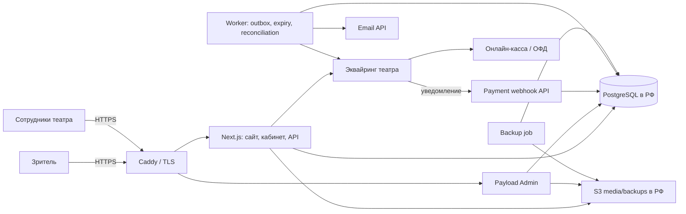

# Architecture — сайт и билетная система театра «Турдус»

**Статус:** целевая архитектура MVP  
**Дата:** 14.10.2026  
**Связанные документы:** `PRD.md`, `rules.md`, `design.md`, `tasks.md`, `memory.md`

## 1. Принципы

1. Один репозиторий и один продуктовый deploy; сайт, API, кабинет и Payload Admin живут внутри Next.js.
2. Payload CMS владеет редакционным контентом и управляет доступом администраторов. Транзакции продажи билетов принадлежат доменному слою приложения и собственным миграциям.
3. Интеграции — через адаптеры с устойчивым внутренним контрактом; в MVP подключается один фактически одобренный банком провайдер.
4. Ни браузер, ни CMS-хук, ни возврат пользователя с платёжной страницы не являются источником истины для состояния платежа.
5. Любой денежный/инвентарный переход атомарен, идемпотентен и журналируется.
6. Фоновые задачи запускаются в отдельном worker-контейнере, а не внутри жизненного цикла web-запроса.
7. Персональные данные, основная БД и резервные копии размещаются на инфраструктуре в РФ; каждого внешнего поставщика нужно отдельно проверить на обработку/трансграничную передачу данных.
8. Не строим систему контроля входа: QR на MVP не означает check-in.

## 2. Технологический стек

| Слой | Решение | Примечание |
|---|---|---|
| Runtime | Node.js 24.x, поддерживаемый патч | Точная версия фиксируется в `.node-version`/Docker image и CI |
| Web/API | Next.js App Router, TypeScript, React | По текущей матрице Payload выбирается совместимая версия Next.js; исходное требование Next.js 15 не считать автоматически совместимым с текущей версией Payload |
| CMS | Payload CMS 3.x | Встроенная админка, коллекции, доступы, загрузки |
| DB | PostgreSQL 16 | Один экземпляр; отдельные миграции для доменных таблиц |
| DB access | Payload Postgres adapter + Drizzle для приложения | Не смешивать бизнес-логику с прямыми правками сгенерированных таблиц Payload |
| UI | React, **HeroUI v3** (на React Aria) + Tailwind CSS v4; раскладка страниц — CSS Modules | Решение заказчика 15.10.2026: весь интерфейс на HeroUI. Тема HeroUI задаётся из наших токенов (`src/styles/heroui-theme.css`). Второй UI-кит не подключать |
| Validation | Zod или единая согласованная библиотека схем | Схема на входе API и в доменном слое |
| QR | `qrcode` | Генерация изображения; подписанный/непредсказуемый токен, без ПД |
| Payment | Один адаптер: ЮKassa **или** Т-Банк | Выбор зависит от договора, СБП, чека и проверки возвратов |
| Email | Российский/подходящий почтовый сервис через интерфейс `EmailProvider` | Выбор NotiSend/Unisender Go после проверки условий и доставки |
| Media/backups | S3-совместимое хранилище в РФ | Подтвердить регион и договорные условия |
| Host | VPS в РФ | 2 vCPU / 4 GB — минимальная отправная точка, размер проверить нагрузочным тестом |
| Edge/TLS | Caddy | HTTPS, reverse proxy, заголовки безопасности |
| Deployment | Docker Compose: `app`, `worker`, `postgres`, `caddy` | `worker` использует тот же image, но отдельную команду процесса |
| Analytics | Яндекс.Метрика | Не инициализировать до применимого согласия пользователя |

### Фиксация версий

Версии закреплены в T-005 (14.10.2026) в `package.json` (точные версии), `pnpm-lock.yaml`, `.node-version`, `Dockerfile` (тег + sha256 digest) и CI. Согласованность проверяет `tests/unit/stack-versions.test.ts`.

| Компонент | Версия | Источник совместимости |
|---|---|---|
| Node.js | 24.21.0 (LTS «Krypton») | Payload 3.90.2 `engines.node`: `^18.20.2 \|\| >=20.9.0`; Next 16 — `>=20.9.0` |
| pnpm | 10.34.6 (через corepack, `packageManager`) | Payload `engines.pnpm`: `^9 \|\| ^10 \|\| ^11` |
| Payload CMS | 3.90.2 (все `@payloadcms/*` той же версии) | — |
| Next.js | 16.4.2 | peer `@payloadcms/next@3.90.2`: `>=16.3.3 <17.0.0` (а также узкие окна 15.2.9+/15.3.9+/15.4.11+) |
| React / React DOM | 19.2.8 | peer `@payloadcms/ui`: `^19.2.1` |
| TypeScript | 5.9.3 | Next 16 требует TS ≥ 5.1; Payload тестируется на 5.7.x; TS 6/7 не берём без отдельной проверки |
| PostgreSQL | 16 (образ закрепить в T-012) | `@payloadcms/db-postgres` (drizzle-orm 0.45.2, pg 8.20.0) |
| Docker base | `node:24.21.0-bookworm-slim@sha256:d6aa75…` | glibc-образ: `sharp` без musl-особенностей |

Правила выбора и обновления:
- 26.10.2026 — исключение из правила 14 дней ради исправлений безопасности (`pnpm audit`: критические уязвимости Next.js ≤ 16.4.0): Next.js и `eslint-config-next` 16.4.2 (релиз 15.10.2026), `zod` 4.6.7, `nodemailer` 10.1.7, overrides `undici` 7.30.1 и `dompurify` 3.4.17. Правило 7 дней (`minimumReleaseAge`) соблюдено без исключений; `happy-dom` 21.0.4 (high, через `@lexical/headless`) и `fast-uri` 3.1.9 (moderate) ему пока не удовлетворяют — обновить override после 27.10.2026.
- Берём только релизы старше 14 дней. Поэтому не Next.js 16.4.0 (релиз 06.10.2026, вне проверенной Payload линии) и не Node 24.22.0 (релиз 14.10.2026). Дополнительная защита — `minimumReleaseAge: 10080` (7 дней) в `pnpm-workspace.yaml`.
- Ранее в документе было указано «документация Payload требует Node.js 24.15.0+ и Next.js 16.4.0+». Это не подтвердилось: документация установки Payload v3.90.2 указывает Node.js 20.9.0+ и Next.js 16.2.6+, а peerDependencies строже (`>=16.3.3`). Источник истины — peerDependencies `@payloadcms/next`/`@payloadcms/ui` конкретной версии.
- Next.js 15 из исходного плана совместим только в узких патч-окнах; на нём не стартуем.
- Патчи безопасности транзитивных зависимостей — через `pnpm.overrides` с минимальным шагом: `payload>undici` 7.29.0→7.29.1, `monaco-editor>dompurify` 3.4.15→3.4.16. Снимать override, когда Payload обновит свою зависимость.
- Принятые риски `pnpm audit` (в `pnpm.auditConfig.ignoreGhsas`, пересматривать при каждом обновлении Payload): GHSA-vfj7-8cjw-p6xm (`braces` через `sass>chokidar` — патча нет; watcher файлов, в рантайме production не используется) и GHSA-67mh-4wv8-2f99 (`esbuild` 0.18 внутри `drizzle-kit` — касается только dev-сервера esbuild, который мы не запускаем).
- Известное безвредное предупреждение peer: `vite@8` (через vitest) ожидает опциональный `esbuild ^0.27`, находит 0.25.12 из drizzle-kit; vite 8 работает на rolldown.
- Нельзя использовать `latest` в production-сборке без lock-файла и CI. Обновления зависимостей проходят CI и тесты оплаты/возврата.

## 3. Контекстная схема



## 4. Границы модулей

```text
src/
  app/
    (public)/                 # главная, афиша, спектакль, театр, корпоративы, контакты, документы
    (account)/                # вход, билеты, бонусы
    (checkout)/               # выбор билетов, статус оплаты
    api/
      checkout/               # создание/получение checkout
      payments/[provider]/webhook/
      orders/[id]/             # безопасный статус заказа
      refunds/                # пользовательский возврат
      auth/email-code/         # запрос и проверка одноразового кода
      leads/                  # публичная форма заявок
  payload/
    collections/              # Shows, Performances, TicketTypes, Venues, Pages, Leads, Settings, AdminUsers
    access/                   # роли и доступы CMS
  modules/
    shows/                    # read models/queries для афиши и спектаклей
    checkout/                 # бизнес-сценарии checkout
    inventory/                # транзакционный резерв/остатки
    payments/                 # PaymentProvider и адаптер выбранного банка
    tickets/                  # выпуск билетов и QR token
    refunds/                  # правила/оркестрация возвратов
    loyalty/                  # ledger, резервы, начисления, сгорания, рефералы
    auth/                     # email OTP, session management
    leads/                    # заявки и переходы статусов
    email/                    # шаблоны и провайдер
    consent/                  # версия документов и журнал согласий
    audit/                    # административный журнал
  jobs/
    process-outbox.ts
    expire-holds.ts
    reconcile-payments.ts
    expire-bonuses.ts
    retry-failed-deliveries.ts
  db/
    schema/                   # собственные Drizzle схемы доменных таблиц
    migrations/               # проверяемые миграции
  lib/
    env.ts                    # проверка env при старте
    logger.ts
    rate-limit.ts
    security.ts
    money.ts
  components/
  styles/
  tests/
    unit/
    integration/
    e2e/
```

Имена могут быть адаптированы под соглашения Next.js/Payload при scaffold, но доменные границы сохраняются. Не создавать одну гигантскую страницу/API-обработчик с платёжной логикой.

## 5. CMS-коллекции

| Коллекция | Важные поля | Правила |
|---|---|---|
| `shows` | title, slug, genre, synopsis, ageLimit, durationMinutes, cast, gallery, trailer, status, SEO | Только `published` видны публично |
| `performances` | show, startsAt, venue, timezone, capacity, salesStartAt, salesEndAt, salesStatus | Дата хранится UTC; отображается в часовом поясе театра |
| `ticketTypes` | performance, title, priceKopecks, capacity, salesStatus, sortOrder | Изменение capacity проходит синхронно с inventory и не может быть ниже `sold + held` |
| `venues` | title, address, lat, lon, directions, accessibilityNotes | Координаты и детали проверяет театр |
| `pages` | slug, title, blocks/rich text, seo, status | Для «О театре», «Корпоративы», «Контакты», документов |
| `leads` | name, email/phone, date, guestCount, format, budget, comment, status, assignee, statusHistory | Личный контакт виден только уполномоченным сотрудникам |
| `siteSettings` | theatreName, timezone, contacts, returnPolicy, loyaltyRules, legalEntityData, SEO defaults | Конфигурация; права только администратору |
| `adminUsers` | email, role, auth fields, MFA fields | Обязательная MFA для админских аккаунтов; кассир не имеет super-admin прав |

Не создавать Payload collection с именами/таблицами, которые конфликтуют с зарезервированными именами собственного слоя. Таблицы приложения получают префикс `commerce_` или чёткие имена в документированной схеме; схема Payload и доменные миграции не должны независимо изменять одну и ту же таблицу.

## 6. Транзакционная модель данных

Идентификаторы — UUID. `created_at`/`updated_at` — timestamptz; суммы — `BIGINT` в копейках. Валюта MVP — RUB. Не хранить денежные значения в float/decimal JS.

### `commerce_customers`
- `id`, `email_normalized UNIQUE`, `full_name NULL`, `phone NULL`.
- `referral_code UNIQUE`, `referred_by_customer_id NULL`, `referral_bound_at NULL`.
- `created_at`, `updated_at`.
- Уникальная нормализация email; не использовать email как публичный идентификатор.

### `commerce_orders`
- `id`, `order_number UNIQUE`, `customer_id`, `status`.
- `gross_amount_kopecks`, `bonus_amount_kopecks`, `cash_amount_kopecks`, `currency`.
- `payment_provider`, `provider_payment_id NULL`, `idempotency_key UNIQUE`.
- `hold_until`, `paid_at NULL`, `cancelled_at NULL`, `refunded_at NULL`.
- Снимок контактных/фискальных данных только в объёме, согласованном с провайдером и политикой хранения.
- Ограничения: все суммы >= 0; `gross = bonus + cash` согласно одному утверждённому правилу расчёта; допустимые переходы статуса проверяет доменный слой.

### `commerce_order_items`
- `id`, `order_id`, `performance_id`, `ticket_type_id`, `quantity`.
- `unit_price_kopecks_snapshot`, `line_gross_kopecks`, `line_bonus_kopecks`, `line_cash_kopecks`.
- Уникальная связь с категорией/показом; все цены — snapshot, а не динамическая ссылка на CMS.

### `commerce_ticket_inventory`
- `ticket_type_id UNIQUE`, `performance_id`, `capacity`, `sold_qty`, `held_qty`, `updated_at`.
- Инварианты: `capacity >= 0`; `sold_qty >= 0`; `held_qty >= 0`; `sold_qty + held_qty <= capacity`.
- Checkout выполняет атомарный `UPDATE ... WHERE sold_qty + held_qty + quantity <= capacity` под транзакцией. Для корзины из нескольких категорий строки блокируются в стабильном порядке ID, чтобы уменьшить риск deadlock.
- При изменении вместимости админом значение нельзя уменьшить ниже уже оплаченного + зарезервированного количества.

### `commerce_seats` и `commerce_seat_inventory` (выбор мест, PRD «Изменения объёма»)
- `commerce_seats`: `id`, `venue_id`, `seating_plan_version`, `section`, `row_number`, `seat_number`, `category_id`; UNIQUE (`venue_id`, `seating_plan_version`, `section`, `row_number`, `seat_number`). Схема зала версионируется: изменение схемы не меняет проданные билеты.
- `commerce_seat_inventory`: `performance_id`, `seat_id`, `status` (`AVAILABLE`, `HELD`, `SOLD`, `BLOCKED`), `order_id NULL`, `hold_until NULL`; PRIMARY KEY (`performance_id`, `seat_id`).
- Резерв: одна транзакция `UPDATE ... SET status='HELD' WHERE performance_id=$1 AND seat_id = ANY($2) AND status='AVAILABLE'` с проверкой, что обновлено ровно столько строк, сколько мест выбрано; иначе откат и ответ «место уже занято». Строки блокируются в порядке `seat_id`.
- Цена места = цена его категории для показа (`commerce_ticket_inventory` по категориям остаётся для площадок без мест). Билет хранит `seat_id`; повторная продажа места после возврата — по тем же правилам, что и квоты.

### `commerce_tickets`
- `id`, `order_item_id`, `ticket_number UNIQUE`, `status` (`ISSUED`, `REFUND_PENDING`, `REFUNDED`).
- `qr_token_version`, `issued_at`, `refunded_at NULL`.
- Токен QR подписывается HMAC/асимметрическим ключом с key version или формируется как непредсказуемая случайная ссылка; секрет находится только на сервере. В токене нет персональных данных.

### `commerce_bonus_accounts`
- `customer_id PRIMARY KEY`, `available_kopecks`, `reserved_kopecks`, `debt_kopecks`, `updated_at`.
- Это транзакционная проекция; неизменяемый `commerce_bonus_entries` — история операций. Любое списание блокирует строку аккаунта пользователя.

### `commerce_bonus_reservations`
- `id`, `order_id UNIQUE`, `customer_id`, `amount_kopecks`, `status` (`ACTIVE`, `CONSUMED`, `RELEASED`), `expires_at`, `created_at`.
- Резерв — отдельный от фактического списания процесс. При отмене брони он освобождается ровно один раз.

### `commerce_bonus_entries` — append-only ledger
- `id`, `customer_id`, `order_id NULL`, `type` (`EARN`, `SPEND`, `REFUND`, `REVERSAL`, `BURN`, `REFERRAL`, `ADJUSTMENT`).
- `amount_kopecks` со знаком, `expires_at NULL`, `source_key UNIQUE`, `reversal_of_id NULL`, `created_at`, `metadata JSONB` без излишних ПД.
- Исходные строки не редактировать и не удалять; исправления — компенсирующими событиями с причиной.

### `commerce_payment_events`
- `id`, `provider`, `provider_object_id`, `event_type`, `dedupe_key UNIQUE`, `payload_digest`, `sanitized_payload JSONB`, `received_at`, `processed_at NULL`, `processing_result`, `correlation_id`.
- Сохранять минимум нужных данных. Не писать платёжные секреты, полные токены/карточные данные и лишние ПД в логи.

### `commerce_refunds`
- `id`, `order_id`, `ticket_ids`, `amount_kopecks`, `provider_refund_id NULL`, `status` (`REQUESTED`, `PENDING`, `SUCCEEDED`, `FAILED`, `MANUAL_REVIEW`), `reason`, `requested_by`, timestamps.
- Ограничить повторный активный возврат одного билета и двойной возврат одной суммы.

### `commerce_outbox_events`
- `id`, `event_type`, `aggregate_type`, `aggregate_id`, `payload JSONB`, `status`, `attempt_count`, `next_attempt_at`, `last_error`, `created_at`, `processed_at NULL`.
- Письма, возвраты, выдача билета и прочие действия, которые нельзя атомарно совместить с внешним API, создаются/планируются через outbox-паттерн.

### `commerce_login_codes`, `commerce_sessions`, `commerce_consent_events`, `commerce_audit_log`
- OTP: хеш кода, email, TTL, счётчик попыток, consumedAt; никогда не хранить код в открытом виде.
- Сессии: хеш идентификатора/секрета, expiry, revokeAt, user agent/IP в минимально необходимом и правомерном объёме.
- Согласия: тип согласия, версия документа, timestamp, источник/форма и версия интерфейса.
- Аудит: actor, action, entity, entityId, timestamp, reason, correlationId; не помещать в аудит секреты.

## 7. Денежные и бонусные правила

- Все суммы внутри приложения — целые копейки; форматирование рублей выполняется только на границе UI/API провайдера.
- Единая функция расчёта заказа определяет `gross`, `bonus` и `cash`; клиент может отправлять только выбор билетов и запрос на использование бонусов, но не итоговые суммы.
- Цены категорий копируются в order items при checkout, чтобы правка CMS не меняла существующий заказ.
- Остаток пересчитывается в транзакционном слое, а не через публичный CMS API.
- Нужно согласовать с банком и бухгалтером, как отражать использованные бонусы в фискальном чеке и налоговом учёте. Не принимать техническое предположение «на чек идёт только cash amount» без подтверждения.
- У возвратов и бонусов единая таблица соответствия возвращённым билетам и долям бонусной оплаты; округление при частичном возврате детерминировано и протестировано.

## 8. Статусы заказов

Разрешённые основные состояния:

```text
PENDING_PAYMENT -> PAID -> REFUND_PENDING -> PARTIALLY_REFUNDED / REFUNDED
PENDING_PAYMENT -> CANCEL_PENDING -> CANCELLED
PENDING_PAYMENT -> PAYMENT_REVIEW
PAID -> PAYMENT_REVIEW (например, подтверждён поздний платёж без остатка)
```

Состояния возврата хранятся также отдельно в `commerce_refunds`. Реализация должна иметь явную таблицу/функцию допустимых переходов. Нельзя менять статус простым присваиванием из непроверенного запроса.

## 9. Покупка — последовательность операций

1. В API проверить схему входа, rate limit, доступность показа и категории.
2. Создать внутренний idempotency key / принять ключ клиента с проверкой области уникальности.
3. В DB-транзакции блокировать строки inventory всех требуемых типов в стабильном порядке.
4. Проверить лимиты и окна продаж, атомарно увеличить `held_qty`; заблокировать bonus account при применении бонусов и создать reservation.
5. Создать `PENDING_PAYMENT` order + order items + запись аудита/события.
6. Вызвать API провайдера с idempotency key; передать сумму, redirect URL, order metadata и корректные реквизиты чека.
7. Сохранить payment ID и confirmation URL. Если запрос провайдера завершился таймаутом с неизвестным результатом, выполнить повтор с тем же idempotency key/сверку, не создавать новый платёж вслепую.
8. Webhook handler быстро сохраняет событие/dedupe key; подтверждает актуальный статус/сумму через API провайдера и запускает доменный обработчик. Для провайдера без криптографической подписи уведомления не считать само по себе достоверным; проверять подпись/IP только по официальной документации и обязательно подтверждать статус у провайдера.
9. В одной DB-транзакции проверить текущий статус и идемпотентно выполнить `PENDING_PAYMENT -> PAID`, `held_qty -= qty`, `sold_qty += qty`, создать билеты, списать резерв бонусов, добавить ledger entries начисления и записать outbox email.
10. Worker отправляет письмо. Сбой email не отменяет покупку; задача повторяется с backoff, затем попадает в ручную очередь.
11. Если оплата подтверждена, но резерв потерян/мест нет: не превышать capacity; создать операцию возврата и уведомить администратора.

## 10. Возвраты

- Клиентский возврат проверяет дату показа, правила `returnPolicy`, статус билета/заказа и наличие активного запроса возврата.
- Административный возврат может обходить временное ограничение по сроку, но не финансовые инварианты, и требует роли + причины.
- Провайдерский запрос имеет устойчивый idempotency key. До подтверждения провайдера билет/заказ находится в `REFUND_PENDING`; повторный запрос не запускает второй денежный возврат.
- После подтверждения возвращённая квота освобождается согласно принятой бизнес-правилом политике: для спектакля без выбора места она может снова продаваться, если продажи не закрыты и времени до показа достаточно. Это поведение утвердить с театром.
- Чек возврата, возврат денежных средств, восстановление использованных бонусов и сторно начисленных бонусов отражаются согласованно и аудитируемо.
- Внутренний статус и API возврата должны различать «запрошен», «в процессе», «подтверждён», «отклонён».

## 11. API-контракты — ориентир

Все API валидируют входы на сервере и возвращают общий формат ошибок без стек-трейсов и внутренних данных.

| Метод/путь | Назначение | Доступ |
|---|---|---|
| `GET /api/shows` | Опубликованная афиша | Public |
| `GET /api/shows/:slug` | Детали спектакля/доступные показы | Public |
| `POST /api/checkout` | Резерв и создание заказа/платежа | Public + rate limit + CSRF/origin policy |
| `GET /api/orders/:publicId/status` | Безопасный статус платежа | Ограниченный signed token/session; не выдавать данные другого пользователя |
| `POST /api/payments/:provider/webhook` | Уведомление провайдера | Провайдер; проверка актуального объекта и дедупликация |
| `POST /api/auth/email-code/request` | Запрос OTP | Public + rate limit |
| `POST /api/auth/email-code/verify` | Проверка OTP и создание сессии | Public + rate limit |
| `GET /api/me/tickets` | Билеты зрителя | Customer session |
| `POST /api/tickets/:id/refund` | Запрос возврата билета | Владелец билета |
| `GET /api/me/bonuses` | Баланс и история | Customer session |
| `GET /api/me/referral` | Ссылка приглашения | Customer session |
| `POST /api/leads` | Создать заявку на корпоратив | Public + rate limit + consent log |

Это контрактная карта, не повод добавлять избыточные endpoint. При реализации уточнить схемы запросов/ответов и описать их тестами.

## 12. Вебхуки и фоновая обработка

`worker` выполняет отдельные идемпотентные jobs:
- истечение броней;
- сверка зависших платежей;
- обработка outbox;
- повторная отправка писем;
- повтор/проверка возвратов и чеков;
- сгорание бонусов;
- чистка давно истёкших OTP/сессий и технических данных по утверждённой политике хранения.

Периодичность — конфигурируемая, из исходного плана стартовый ориентир 5 минут. Обработчики должны быть безопасны при повторном запуске и при нескольких экземплярах worker. Использовать DB lock/claim (`FOR UPDATE SKIP LOCKED` там, где применимо) и уникальные ключи событий, а не предполагать «задача запустится ровно один раз».

## 13. Безопасность

- Секреты только в серверном env/менеджере секретов; `.env` не коммитить. В client bundle допускаются только явно публичные переменные.
- Публичный API: серверная валидация, лимиты по IP и идентификатору, контроль origin/CSRF для cookie-сессий, безопасные ошибки.
- OTP: хеширование, TTL, лимит попыток, ограничение отправки, нейтральный текст ответа против перечисления аккаунтов.
- Admin: MFA TOTP или согласованный эквивалент обязателен; recovery-коды хранятся только в хешированном виде; роли проверяются на сервере.
- Webhook: HTTPS, ограничение размера payload, дедупликация, проверка подлинности по официальной документации провайдера, обязательная server-to-server проверка фактического объекта платежа.
- QR: случайный/подписанный токен, rotation/key version, отсутствие ПД; секрет подписи — в env и с процедурой ротации.
- БД: отдельный непривилегированный runtime user; миграции — отдельными правами; резервные копии зашифрованы и доступны ограниченному кругу.
- Логи: редактировать email/телефон/токены/платёжные параметры; не записывать коды OTP или полные секретные payload.
- Зависимости: lock-файл, обновления через CI, автоматический анализ уязвимостей и ручная проверка критических обновлений.
- Формы и покупки: явное согласие на нужную обработку; отдельное необязательное согласие на маркетинг не добавлять, так как рассылки не входят в scope.

## 14. ПД, cookie и 54-ФЗ

- Театр — оператор персональных данных; договор с исполнителем должен закрепить обработку по поручению, набор данных, цели, меры безопасности, сроки и порядок реагирования.
- Сбор и первичная запись/систематизация данных должны происходить на инфраструктуре в РФ с учётом действующей редакции 152-ФЗ. Российский регион S3 сам по себе не делает внешнего email/аналитического поставщика автоматически соответствующим требованиям.
- Тексты политики, согласий, cookie и возврата предоставляет/утверждает театр при проверке специалистом по праву.
- Для Яндекс.Метрики используется механизм согласия и реальное блокирование счётчика до разрешения, где оно необходимо. Не считать наличие баннера достаточным доказательством соблюдения требований.
- Ставку/режим НДС, предмет расчёта, признак способа расчёта и формат скидки/бонусов письменно подтверждают бухгалтер театра и эквайринговый провайдер до live-платежей.
- Чек и чек возврата должны проверяться по фактическому статусу у провайдера/кассы, а не только по HTTP-успеху платежного API.

## 15. Деплой, резервирование и эксплуатация

### Compose-сервисы
- `app`: Next.js + Payload.
- `worker`: тот же образ, отдельная команда job runner.
- `postgres`: PostgreSQL 16, закрыт от внешнего доступа; persistent volume.
- `caddy`: внешний HTTPS и reverse proxy.

### Переменные окружения
Пример `.env.example` должен содержать только имена переменных без секретных значений: `DATABASE_URL`, `PAYLOAD_SECRET`, `PUBLIC_SITE_URL`, `THEATRE_TIMEZONE`, `PAYMENT_PROVIDER`, `PAYMENT_MERCHANT_ID`, `PAYMENT_SECRET_KEY`, `PAYMENT_WEBHOOK_SECRET` (если провайдер использует), `EMAIL_PROVIDER`, `EMAIL_API_KEY`, `S3_ENDPOINT`, `S3_BUCKET`, `S3_REGION`, `S3_ACCESS_KEY_ID`, `S3_SECRET_ACCESS_KEY`, `QR_SIGNING_KEY`, `SESSION_SECRET`, `LOG_LEVEL`.

Проверять и валидировать обязательные env при старте. Секреты не включать в diagnostic endpoint.

### Бэкапы
- Ежедневный `pg_dump` в шифрованное хранилище S3 в РФ; медиа защищаются версионированием/backup-политикой.
- Для продуктивной системы отдельно определить RPO/RTO с театром. «Восстановление за час» — целевой ориентир, не гарантия до тестового восстановления.
- Минимум перед запуском и далее по расписанию выполнить тест восстановления БД и проверки доступности медиа.
- Бэкапы, доступы и ключи восстановления не должны зависеть только от аккаунта исполнителя.

### Наблюдаемость
- Структурированные логи + correlation ID для заказа и платёжного события.
- Проверки HTTPS/health endpoint, места на диске, БД, worker heartbeat и ошибок backup.
- Сигналы/уведомления: накопившийся outbox, зависшие `PENDING_PAYMENT`, ошибки чеков, превышение retries, failed backup.
- Описанный runbook: «платёж списан, билет не пришёл», «дубли вебхука», «возврат завис», «чек не сформирован», «нет места на диске», «восстановление из бэкапа».

## 16. CI/CD и тестирование

- PR должен проходить lint, typecheck, unit tests, integration tests и production build.
- Миграции проверяются на пустой БД и на копии БД предыдущей версии; деструктивная миграция требует отдельного review и backup.
- E2E smoke на preview/staging: афиша, checkout sandbox, webhook fixture, выпуск билета, email outbox, кабинет, возврат sandbox.
- Перед продом — ручные 3–5 реальных оплат и 1 возврат после согласования с театром; сверить transaction ID, сумму, билет, письмо и чек.
- Обязательно нагрузочный/конкурентный тест на лимит последнего билета.

## 17. Архитектурные решения (ADR)

- **ADR-001 — единый монолит:** Next.js + Payload в одном приложении; worker — отдельный процесс того же репозитория.
- **ADR-002 — Postgres как источник транзакционной истины:** CMS хранит редакционный контент, commerce-таблицы — заказы/билеты/инвентарь/ledger.
- **ADR-003 — единственный провайдер в MVP:** не реализовывать оба банка одновременно до появления бизнес-потребности.
- **ADR-004 — inventory ledger:** инвентарь резервируется атомарно; не рассчитывать наличие простым запросом из браузера или только по предварительно подсчитанным live holds.
- **ADR-005 — outbox:** внешние сообщения/побочные эффекты надёжно повторяются после фиксации транзакции.
- **ADR-006 — QR не check-in:** контроль входа исключён из MVP.
- **ADR-007 — versions locked:** закрепить совместимую матрицу Next/Payload/Node/TS; не использовать динамические `latest` в production.

## 18. Внешние технические источники

Проверить перед реализацией/релизом:
- Payload installation/совместимость: https://payloadcms.com/docs/getting-started/installation
- Payload PostgreSQL adapter: https://payloadcms.com/docs/database/postgres
- Next.js upgrade guide: https://nextjs.org/docs/app/guides/upgrading
- PostgreSQL transaction isolation/locking: https://www.postgresql.org/docs/current/transaction-iso.html
- ЮKassa webhook notifications: https://yookassa.ru/developers/using-api/webhooks
- ЮKassa checkout/idempotency: https://yookassa.ru/developers/payment-acceptance/getting-started/payment-process и https://yookassa.ru/developers/using-api/interaction-format
- ЮKassa receipts for payments/refunds: https://yookassa.ru/developers/payment-acceptance/receipts/54fz/yoomoney/payments и https://yookassa.ru/developers/payment-acceptance/receipts/54fz/yoomoney/refunds
- 152-ФЗ, статья 18: https://www.consultant.ru/document/Cons_doc_LAW_61801/cbf4e15b7c330f9372e876cdf2bc928bad7950ef/

Документация провайдера — технический источник, но не замена согласованию договора, чека и налоговых параметров с конкретным банком и бухгалтером.
