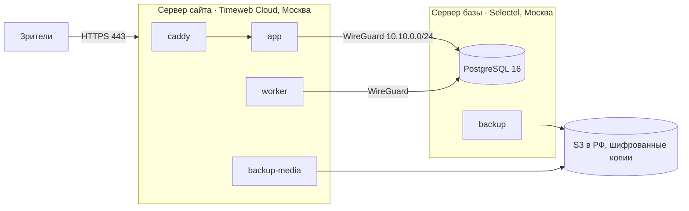

# План — сайт и база на разных серверах (T-016)

**Состояние на 27.10.2026.** Решение заказчика: сайт и данные пользователей — на двух VPS у разных хостеров. Задача — [`tasks.md`](../tasks.md) T-016; общий план — [`plan-main.md`](plan-main.md).

## 1. Схема

- **Сервер сайта:** `caddy`, `app`, `worker`, `migrate`, бэкап медиа. Наружу — только 80/443 и SSH.
- **Сервер базы:** `postgres`, `backup`. Наружу — только WireGuard (UDP) и SSH. Порт 5432 в интернет не открыт.
- **Оба сервера в одном городе (Москва):** задержка между ними 1–3 мс. В разных городах страницы Payload заметно замедлятся.
- **Оба в РФ:** сайт тоже обрабатывает ПД (формы, вход) — 152-ФЗ, `architecture.md` §14.

## 2. Серверы

| | Сервер сайта | Сервер базы |
|---|---|---|
| Хостер | Timeweb Cloud, Москва | Selectel, Москва (запасной вариант — Yandex Cloud Managed PostgreSQL) |
| Старт | 2 vCPU / 2 ГБ / 30 ГБ NVMe | 1 vCPU / 1 ГБ / 20 ГБ NVMe |
| С запасом (премьеры, сборка на сервере) | 2 vCPU / 4 ГБ / 40 ГБ NVMe | 1 vCPU / 2 ГБ / 20 ГБ NVMe |
| ОС | Ubuntu 24.04 LTS, Docker Engine + compose plugin | то же |

2 ГБ на сервере сайта хватит, если образ собирается в CI и приезжает готовым (этап 3). Тарифы — сверить на сайтах хостеров перед заказом; в облаке размер меняется за минуты.

## 3. Этапы

### Этап 1. Заказ и базовая настройка (театр + разработчик)

1. Театр заказывает оба сервера на свой аккаунт/юрлицо (T-076: сервер — собственность театра). У Selectel — договор поручения на обработку ПД.
2. На обоих: пользователь без root, вход только по SSH-ключу, `PasswordAuthentication no`, `ufw` (deny по умолчанию), `unattended-upgrades`, синхронизация времени, часовой пояс UTC.
3. Docker Engine + compose plugin из официального репозитория.

**Готово:** оба сервера доступны по ключу, всё лишнее закрыто, `docker compose version` работает.

### Этап 2. Канал между серверами — WireGuard

1. Сервер базы — `10.10.0.1`, сервер сайта — `10.10.0.2`, `PersistentKeepalive = 25`.
2. Файрвол сервера базы: UDP-порт WireGuard — только с публичного IP сервера сайта; 5432 — только с `10.10.0.2` через `wg0`.
3. Конфиги — в `deploy/wireguard/*.conf.example` (ключи не в git).

**Готово:** `ping 10.10.0.1` с сервера сайта проходит; `nc -z <публичный IP базы> 5432` из интернета — закрыто.

### Этап 3. Разделить compose (код, делается до серверов)

1. `deploy/site/docker-compose.yml` — `caddy`, `migrate`, `app`, `worker`, `backup-media`. Без `postgres`; `DATABASE_URL=postgres://trds:…@10.10.0.1:5432/trds`.
2. `deploy/db/docker-compose.yml` — `postgres` (порт публикуется только на `10.10.0.1:5432`) и `backup`.
3. PostgreSQL: `listen_addresses` — внутри контейнера как сейчас; `pg_hba.conf` — `scram-sha-256` только для подсети `10.10.0.0/24`; отдельная роль приложения без прав суперпользователя; `max_connections` с учётом пулов `app` + `worker`.
4. Образ приложения: сборка в GitHub Actions → GitHub Container Registry (приватный) → на сервере `docker compose pull`. Сборка на сервере остаётся запасным путём.
5. Текущий `docker-compose.yml` в корне оставить для локального запуска «всё на одной машине».

**Готово:** оба compose проходят `docker compose config`; локально два compose поднимаются в двух сетях и сайт работает через «внешний» адрес базы.

### Этап 4. Бэкапы и health после разделения (код)

Сейчас `backup` пишет `backup-status.json` в общий том `ops-state`, а `/api/health` его читает; медиа бэкапятся тем же сервисом. После разделения тома общими не будут.

1. **Статус бэкапа — в БД:** `scripts/backup.sh` в конце пишет итог в таблицу `ops_backup_status` (новая миграция); `/api/health` читает её вместо файла. Файл оставить как запасной путь для локального запуска.
2. **Медиа:** до S3 (T-020) — отдельный `backup-media` на сервере сайта (архив тома `media` → S3); после подключения S3 медиа живут в бакете с версионированием, и этот сервис не нужен.
3. **Внешняя копия:** оба бэкапа → S3 в РФ (третий поставщик или Selectel S3, но не на тот же сервер), шифрование `age`/`gpg` до отправки, ключ расшифровки хранится у театра отдельно.

**Готово:** тесты на запись/чтение статуса; `/api/health` = degraded при просроченном бэкапе в схеме из двух серверов.

### Этап 5. Первый деплой

1. Сервер базы: `docker compose up -d`, проверка `pg_isready` через туннель.
2. Сервер сайта: `.env` (секреты — только на сервере), `docker compose pull && up -d`; `migrate` прогоняет миграции на удалённой базе.
3. DNS домена → IP сервера сайта; Caddy получает сертификат.
4. Перенос данных (если появятся до запуска): `pg_dump` → `scripts/restore.sh` на сервере базы.

**Готово:** сайт и админка открываются по домену; `/api/health` = ok; в логах нет ошибок подключения к базе.

### Этап 6. Проверки до запуска

1. **Учения восстановления** (T-014, T-072) на новой схеме: восстановить базу на чистом сервере из S3-копии, сверить строки (`runbook.md` §7).
2. **Обрыв туннеля:** остановить `wg0` на минуту → сайт отдаёт понятную ошибку, `/api/health` = fail; после подъёма — восстанавливается сам, без перезапуска контейнеров.
3. **Нагрузка** (T-071): «последний билет» и открытие продаж — время ответа с учётом сети до базы.
4. **Внешний мониторинг** (T-015): проверка `/api/health` раз в минуту, оповещение театру и разработчику.

**Готово:** результаты занесены в `docs/runbook.md`.

### Этап 7. Документация и передача

- `docs/runbook.md`: какие сервисы где работают, перезапуск каждого сервера, ротация ключей WireGuard и пароля БД, восстановление.
- `docs/handover.md`: доступы к двум хостерам, S3, ключам шифрования; кто отвечает за оплату серверов.
- `architecture.md` §15 и `memory.md` — новая схема развёртывания.

## 4. Порядок и зависимости

| Этап | Кто | Зависит от |
|---|---|---|
| 3, 4 — код | разработчик | ничего, можно начинать сейчас |
| 1 — заказ серверов | театр | T-004 (доступы, юрлицо) |
| 2, 5 — туннель, деплой | разработчик | этап 1, домен (T-004) |
| 6 — проверки | разработчик | этап 5; S3 выбран |
| 7 — передача | разработчик + театр | этап 6 |

## 5. Риски

- **Доступность не растёт:** падение любого из двух серверов = сайт не работает. Выигрыш — изоляция: взлом сайта не даёт прямого доступа к диску базы, у каждого хостера свои доступы.
- **Задержка:** если хостер разместит серверы не в Москве, страницы замедлятся — проверить регион при заказе.
- **Туннель — новая точка отказа:** нужен мониторинг (этап 6) и инструкция в runbook.
- **Стоимость:** два счёта и S3 вместо одного сервера — сверить с бюджетом в `memory.md`.
